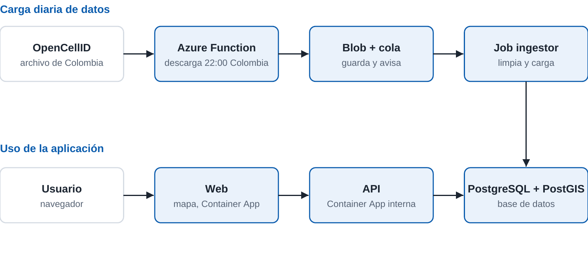

# Plataforma cloud-native de celdas para Colombia

**Materia:** Software de Conectividad  
**Profesor:** Luis Fernando González De La Calle  
**Integrantes:** Duarte, Garzón, Rodríguez y Vásquez

**Aplicación en Azure:** https://ca-web.grayplant-212e438e.northcentralus.azurecontainerapps.io

> Proyecto académico. El cliente es un caso de estudio, no una empresa real.

## 1. Caso de negocio

**Cliente:** una empresa de rastreo de flotas en Colombia.

**Problema:** cuando falla el GPS, la empresa pierde la ubicación de sus dispositivos. Tampoco tiene una vista sencilla de las celdas registradas por red en cada zona.

**Solución:** una plataforma propia que guarda los datos abiertos de OpenCellID para Colombia, estima la ubicación de un dispositivo con las celdas que detecta y muestra las celdas en un mapa.

La plataforma consulta una copia propia de los datos. Así no depende de OpenCellID en cada solicitud ni del límite de 1.000 créditos diarios de su API.

## 2. Trabajo realizado

- Diseño de una arquitectura de microservicios: web, API e ingestor.
- API con FastAPI para buscar celdas, listar redes y estimar una ubicación.
- Mapa web con Leaflet.
- Carga y limpieza de datos en PostgreSQL con PostGIS.
- Contenedores con Docker y pruebas locales con Docker Compose.
- Despliegue en Kubernetes con réplicas, chequeos de salud y autoescalado.
- CI/CD con GitHub Actions.
- Infraestructura en Azure con Terraform.
- Pruebas de falla y de carga.

## 3. Arquitectura



| Requisito | Cómo se cumple |
|---|---|
| Microservicios | `web`, `api` e `ingestor` son servicios independientes |
| Contenedores y orquestación | Docker, Kubernetes y Azure Container Apps |
| CI/CD | GitHub Actions ejecuta pruebas y publica imágenes |
| Serverless | Azure Function diseñada para la descarga diaria; web y API escalan a cero |
| Resiliencia y escalado | Réplicas, recuperación automática de pods y autoescalado |
| Seguridad | Secretos fuera del repositorio; la API no tiene acceso público directo |

La función y el trabajo automático de carga están diseñados en el código, pero todavía no quedaron activos en Azure. Consulta la sección 7.

## 4. Decisiones técnicas

| Decisión | Motivo | Costo aceptado |
|---|---|---|
| Copia propia de los datos | Evita depender de la API externa en cada solicitud | Los datos no son en tiempo real |
| Azure Container Apps | Consume menos crédito que dejar un clúster encendido | Parte de la configuración depende de Azure |
| Kubernetes en GitHub Codespaces | Permite demostrar portabilidad sin saturar el computador local | No es el entorno de producción |
| PostgreSQL con PostGIS | Permite búsquedas por distancia | Requiere una base de datos administrada |

## 5. Resultados

| Prueba de carga (20 usuarios, 5 minutos) | Azure | Kubernetes en Codespaces |
|---|---|---|
| Solicitudes | 4.536 | 4.747 |
| Errores | 0,00 % | 0,00 % |
| Latencia p95 | 76,37 ms | 43,93 ms |

La prueba de Azure se lanzó desde GitHub Codespaces hacia la aplicación publicada, así que incluye el recorrido por la red.

- **Datos cargados:** 16.214 filas, 0 rechazadas.
- **Prueba de falla:** Kubernetes recreó el pod de la API borrado.
- **Despliegue:** web y API funcionando en Azure, región North Central US.

**Crédito de Azure consumido:** USD 2,61 al 4 de noviembre de 2026 (cifra aproximada; Azure puede tardar en actualizarla).

## 6. Evidencias

| Evidencia | Archivo |
|---|---|
| Mapa en Azure | [mapa-azure.png](docs/evidencia/mapa-azure.png) |
| Mapa en Kubernetes | [mapa-kubernetes.png](docs/evidencia/mapa-kubernetes.png) |
| Mapa local con Docker | [mapa-local-docker.png](docs/evidencia/mapa-local-docker.png) |
| Carga de datos | [carga-datos.png](docs/evidencia/carga-datos.png) |
| Pods de Kubernetes | [pods-kubernetes.png](docs/evidencia/pods-kubernetes.png) |
| Prueba de carga en Azure | [prueba-carga-azure.png](docs/evidencia/prueba-carga-azure.png) |
| Prueba de carga en Kubernetes | [prueba-carga-k6.png](docs/evidencia/prueba-carga-k6.png) |
| GitHub Actions | [github-actions.png](docs/evidencia/github-actions.png) |

## 7. Limitaciones y pendientes

- La actualización diaria automática aún no está activa en Azure. La Azure Function y `job-ingestor` están pendientes de despliegue.
- Los datos de Azure se cargaron una vez, de forma manual, desde GitHub Codespaces.
- El flujo `Deploy` termina con error porque espera `job-ingestor`, aunque la web y la API sí se actualizan.
- Ajustes hechos directamente en Azure, como el modo del entorno y el acceso interno de la API, deben pasarse a Terraform.
- Las ubicaciones son estimadas y no representan torres confirmadas.
- Las descargas incluyen celdas vistas en los últimos 18 meses, y la cobertura depende de la comunidad.

## 8. Problemas resueltos

| Problema | Causa | Solución |
|---|---|---|
| Fallaba la publicación de imágenes | El registro usaba mayúsculas | Usar minúsculas |
| Kubernetes no iniciaba en el computador local | Falta de memoria | Usar GitHub Codespaces |
| El mapa bloqueaba el fondo en Codespaces | Política de referencia del navegador | Configurar `referrerPolicy` en Leaflet |
| GitHub no podía entrar a Azure | El identificador de GitHub no coincidía | Registrar el identificador correcto |
| Azure no creaba el Job | El entorno estaba en modo Express | Cambiar el entorno a `WorkloadProfiles` |
| La web recibía error 426 de la API | Nginx usaba HTTP 1.0 | Usar HTTP 1.1 |

## 9. Cómo ejecutarlo

```bash
cp .env.example .env
docker compose up -d --build
docker compose run --rm ingestor python ingest.py /data/732.csv.gz
```

Antes de cargar los datos, coloca el archivo de Colombia en `data/732.csv.gz`.

- Web: http://localhost:8080
- API: http://localhost:8000/docs

## 10. Licencia de los datos

Cell tower data from [OpenCellID](https://opencellid.org), licensed under [CC BY-SA 4.0](https://creativecommons.org/licenses/by-sa/4.0/).
