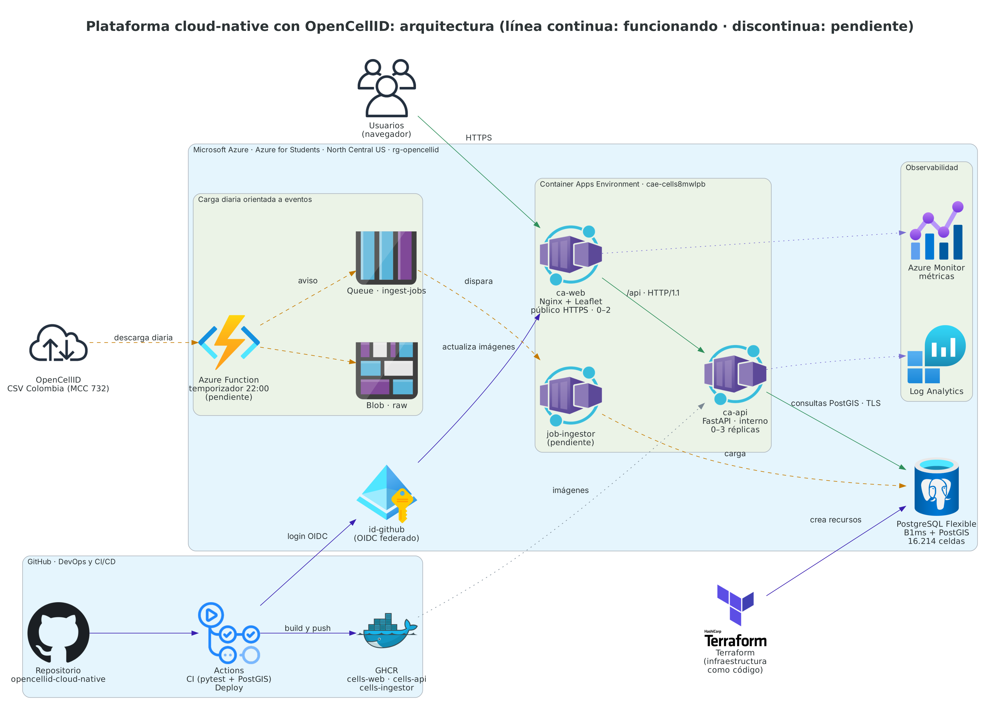
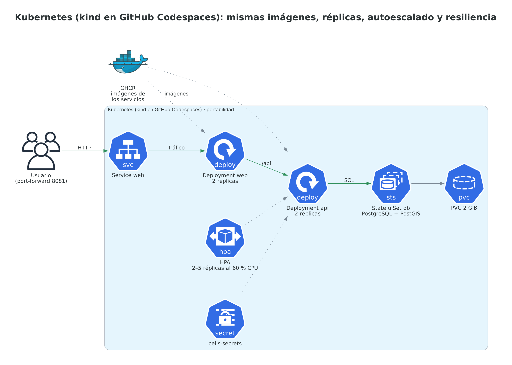

# Plataforma cloud-native de celdas para Colombia

**Materia:** Software de Conectividad  
**Profesor:** Luis Fernando González De La Calle  
**Integrantes:** Duarte, Garzón, Rodríguez y Vásquez

## Accesos y entregables

| Entregable | Enlace |
|---|---|
| Aplicación en Azure | https://ca-web.grayplant-212e438e.northcentralus.azurecontainerapps.io |
| Código fuente | https://github.com/Neuta1996/opencellid-cloud-native |
| Ejecuciones de CI/CD | https://github.com/Neuta1996/opencellid-cloud-native/actions |
| Registro de funcionamiento | [docs/evidencia/registro-funcionamiento.md](docs/evidencia/registro-funcionamiento.md) |

La aplicación responde cuando la base de datos está encendida; se apaga fuera de las revisiones para ahorrar crédito.

## Documentación

1. [Arquitectura](docs/01-arquitectura.md): diagramas con íconos estándar, componentes y flujos.
2. [Guía de despliegue](docs/02-despliegue.md): local, Kubernetes, Azure con Terraform y CI/CD.
3. [API](docs/03-api.md): endpoints, ejemplos y pruebas.
4. [Accesos, operación y registro de funcionamiento](docs/04-operacion-y-evidencias.md): evidencias, resultados y costos.
5. [Uso y manejo de la IA](docs/05-uso-de-ia.md): cómo se usó, dirigió y verificó.

> Proyecto académico. El cliente es un caso de estudio, no una empresa real.

## 1. Caso de negocio

**Cliente:** una empresa de rastreo de flotas en Colombia.

**Problema:** cuando falla el GPS, la empresa pierde la ubicación de sus dispositivos. Tampoco tiene una vista sencilla de las celdas registradas por red en cada zona.

**Solución:** una plataforma propia que guarda los datos abiertos de OpenCellID para Colombia, estima la ubicación de un dispositivo con las celdas que detecta y muestra las celdas en un mapa.

La plataforma consulta una copia propia de los datos. Así no depende de OpenCellID en cada solicitud ni del límite de 1.000 créditos diarios de su API.

## 2. Trabajo realizado

- Diseño de una arquitectura de microservicios: web, API e ingestor.
- API con FastAPI para buscar celdas, listar redes y estimar una ubicación.
- Mapa web con Leaflet y botón **«Mi ubicación»**: con permiso del navegador, muestra a la persona en el mapa y las celdas a 2 km. La ubicación no se guarda.
- Carga y limpieza de datos en PostgreSQL con PostGIS.
- Contenedores con Docker y pruebas locales con Docker Compose.
- Despliegue en Kubernetes con réplicas, chequeos de salud y autoescalado.
- CI/CD con GitHub Actions.
- Infraestructura en Azure con Terraform.
- Pruebas de falla y de carga.

## 3. Arquitectura

Diagramas generados como código con los íconos oficiales de Azure y Kubernetes ([docs/diagrama/diagrama.py](docs/diagrama/diagrama.py)). Todos los componentes están funcionando.





Detalle de componentes y flujos: [docs/01-arquitectura.md](docs/01-arquitectura.md).

| Requisito | Cómo se cumple |
|---|---|
| Microservicios | `web`, `api` e `ingestor` son servicios independientes |
| Contenedores y orquestación | Docker, Kubernetes y Azure Container Apps |
| CI/CD | GitHub Actions ejecuta pruebas y publica imágenes |
| Serverless | Azure Function con temporizador diario y Job disparado por cola; web y API escalan a cero |
| Resiliencia y escalado | Réplicas, recuperación automática de pods y autoescalado |
| Seguridad | Secretos fuera del repositorio; la API no tiene acceso público directo |

La función y el trabajo automático de carga están diseñados en el código, pero todavía no quedaron activos en Azure. Consulta la sección 7.

## 4. Decisiones técnicas

| Decisión | Motivo | Costo aceptado |
|---|---|---|
| Copia propia de los datos | Evita depender de la API externa en cada solicitud | Los datos no son en tiempo real |
| Azure Container Apps | Consume menos crédito que dejar un clúster encendido | Parte de la configuración depende de Azure |
| Kubernetes en GitHub Codespaces | Permite demostrar portabilidad sin saturar el computador local | No es el entorno de producción |
| PostgreSQL con PostGIS | Permite búsquedas por distancia | Requiere una base de datos administrada |

## 5. Resultados

| Prueba de carga (20 usuarios, 5 minutos) | Azure | Kubernetes en Codespaces |
|---|---|---|
| Solicitudes | 4.536 | 4.747 |
| Errores | 0,00 % | 0,00 % |
| Latencia p95 | 76,37 ms | 43,93 ms |

La prueba de Azure se lanzó desde GitHub Codespaces hacia la aplicación publicada, así que incluye el recorrido por la red.

- **Datos cargados:** 16.214 filas, 0 rechazadas.
- **Prueba de falla:** Kubernetes recreó el pod de la API borrado.
- **Despliegue:** web y API funcionando en Azure, región North Central US.
- **Carga diaria automática:** la Azure Function descargó el archivo de Colombia todos los días a las 22:00 desde el 5 de noviembre de 2026. Del 20 al 25 de noviembre, `job-ingestor` hizo 6 cargas seguidas exitosas, de unas 16.400 filas cada una y 0 rechazadas. Detalle en el [registro de funcionamiento](docs/evidencia/registro-funcionamiento.md).

**Crédito de Azure consumido:** USD 3,70 al 4 de noviembre de 2026, según Análisis de costos de Azure.

## 6. Evidencias

| Evidencia | Archivo |
|---|---|
| Mapa en Azure | [mapa-azure.png](docs/evidencia/mapa-azure.png) |
| Botón «Mi ubicación» en celular | [mi-ubicacion.png](docs/evidencia/mi-ubicacion.png) |
| Mapa en Kubernetes | [mapa-kubernetes.png](docs/evidencia/mapa-kubernetes.png) |
| Mapa local con Docker | [mapa-local-docker.png](docs/evidencia/mapa-local-docker.png) |
| Carga de datos | [carga-datos.png](docs/evidencia/carga-datos.png) |
| Pods de Kubernetes | [pods-kubernetes.png](docs/evidencia/pods-kubernetes.png) |
| Prueba de carga en Azure | [prueba-carga-azure.png](docs/evidencia/prueba-carga-azure.png) |
| Prueba de carga en Kubernetes | [prueba-carga-k6.png](docs/evidencia/prueba-carga-k6.png) |
| GitHub Actions | [github-actions.png](docs/evidencia/github-actions.png) |
| Registro de funcionamiento | [registro-funcionamiento.md](docs/evidencia/registro-funcionamiento.md) |

## 7. Limitaciones y mejoras

- El 19 de noviembre de 2026, una carga falló, se reintentó 3 veces y se descartó, como está diseñado. Mientras el mensaje esperaba reintento, KEDA lanzó una ejecución por minuto sin trabajo; se puede mejorar con una cola de mensajes fallidos.
- Algunos cambios se hicieron a mano en Azure y deben pasarse a Terraform.
- Los datos de Azure se cargaron una vez, de forma manual, desde GitHub Codespaces.
- La primera carga de datos se hizo de forma manual desde Codespaces, antes de que existiera el Job.
- Ajustes hechos directamente en Azure, como el modo del entorno y el acceso interno de la API, deben pasarse a Terraform.
- Las ubicaciones son estimadas y no representan torres confirmadas.
- Las descargas incluyen celdas vistas en los últimos 18 meses, y la cobertura depende de la comunidad.

## 8. Problemas resueltos

| Problema | Causa | Solución |
|---|---|---|
| Fallaba la publicación de imágenes | El registro usaba mayúsculas | Usar minúsculas |
| Kubernetes no iniciaba en el computador local | Falta de memoria | Usar GitHub Codespaces |
| El mapa bloqueaba el fondo en Codespaces | Política de referencia del navegador | Configurar `referrerPolicy` en Leaflet |
| GitHub no podía entrar a Azure | El identificador de GitHub no coincidía | Registrar el identificador correcto |
| Azure no creaba el Job | El entorno estaba en modo Express | Cambiar el entorno a `WorkloadProfiles` |
| La web recibía error 426 de la API | Nginx usaba HTTP 1.0 | Usar HTTP 1.1 |

## 9. Cómo ejecutarlo

```bash
cp .env.example .env
docker compose up -d --build
docker compose run --rm ingestor python ingest.py /data/732.csv.gz
```

Antes de cargar los datos, coloca el archivo de Colombia en `data/732.csv.gz`.

- Web: http://localhost:8080
- API: http://localhost:8000/docs

## 10. Licencia de los datos

Cell tower data from [OpenCellID](https://opencellid.org), licensed under [CC BY-SA 4.0](https://creativecommons.org/licenses/by-sa/4.0/).
