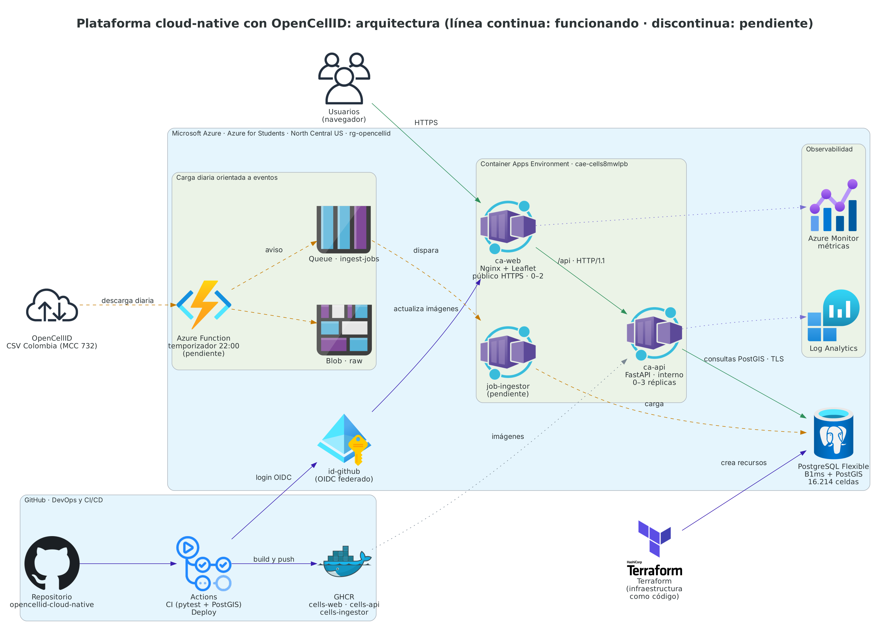
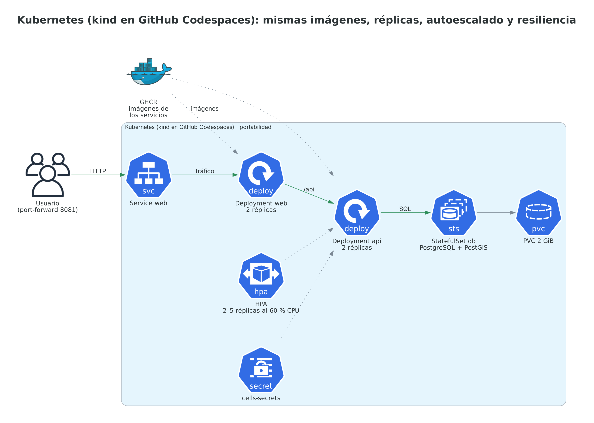

# 1. Arquitectura

Los diagramas usan los íconos oficiales de arquitectura de Azure y de Kubernetes. Se generan como código con la librería [`diagrams`](https://diagrams.mingrammer.com/), en [`docs/diagrama/diagrama.py`](diagrama/diagrama.py):

```bash
pip install diagrams      # requiere Graphviz
python docs/diagrama/diagrama.py
```

**Convención:** línea continua = funcionando; línea discontinua naranja = diseñado, pendiente de activar.

## 1.1 Vista general en Azure



## 1.2 Vista de Kubernetes



## 1.3 Componentes

| Componente | Servicio | Función | Estado |
|---|---|---|---|
| `ca-web` | Azure Container Apps | Nginx sirve el mapa (Leaflet) y reenvía `/api` a la API. Público por HTTPS. 0–2 réplicas | Funcionando |
| `ca-api` | Azure Container Apps | API REST en FastAPI. Acceso solo interno. 0–3 réplicas; chequeos `/health` y `/ready` | Funcionando |
| `psql-cells8mwlpb` | PostgreSQL Flexible Server B1ms | Datos de celdas con PostGIS e índice geográfico. TLS obligatorio | Funcionando |
| `stcells8mwlpb` | Storage Account | Blob `raw` para el CSV original y cola `ingest-jobs` | Creado |
| `func-cells8mwlpb` | Azure Functions (Flex Consumption) | Descarga diaria de OpenCellID a las 22:00 de Colombia | Desplegada el 4 de noviembre de 2026 |
| `job-ingestor` | Container Apps Job | Se dispara por la cola, limpia y carga los datos | Creado; se actualiza en cada `Deploy` |
| `log-cells8mwlpb`, `appi-cells8mwlpb` | Log Analytics, Application Insights | Registros, métricas y monitoreo | Funcionando |
| `id-github` | Identidad administrada | Permite a GitHub Actions entrar a Azure por OIDC, sin contraseñas | Funcionando |
| GHCR | GitHub Container Registry | Imágenes `cells-web`, `cells-api` y `cells-ingestor` | Funcionando |
| Kubernetes | kind en GitHub Codespaces | Mismas imágenes con réplicas, HPA y StatefulSet | Funcionando |

## 1.4 Flujos

**Consulta de un usuario**

1. El navegador abre `ca-web` por HTTPS.
2. Al hacer clic en el mapa, la web pide `/api/v1/cells/nearby`.
3. Nginx reenvía la solicitud a `ca-api` por la red interna, con HTTP/1.1.
4. La API valida los parámetros y consulta PostGIS con `ST_DWithin` en un radio de 2 km.
5. La respuesta incluye las celdas y la atribución de OpenCellID.
6. El mapa dibuja cada celda como una ubicación estimada.

**Carga diaria automática**

1. La Azure Function descarga el CSV de Colombia una vez al día.
2. Lo guarda en Blob Storage y deja un mensaje en la cola.
3. KEDA detecta el mensaje y ejecuta `job-ingestor`.
4. El ingestor valida filas, quita duplicados y hace un *upsert* en una sola transacción.
5. Si falla, el mensaje vuelve a la cola y se reintenta hasta 3 veces.

La primera carga se hizo de forma manual con el mismo ingestor, ejecutado desde Codespaces, antes de que existiera el Job. Las ejecuciones automáticas quedan en el registro de funcionamiento.

## 1.5 Principios cloud-native

| Principio | Cómo se aplica |
|---|---|
| Microservicios | `web`, `api` e `ingestor` se despliegan y escalan por separado |
| Contenedores | Un `Dockerfile` por servicio |
| Orquestación | Kubernetes y Azure Container Apps |
| CI/CD | GitHub Actions: pruebas, imágenes y despliegue |
| Serverless | Escalado a cero de web y API; función diaria |
| Infraestructura como código | Terraform en [`infra/`](../infra) |
| Observabilidad | Log Analytics y métricas de Azure Monitor |
| Portabilidad | Las mismas imágenes corren en Docker, Kubernetes y Azure |
| Seguridad | API sin acceso público, secretos fuera del código, TLS en la base de datos |
